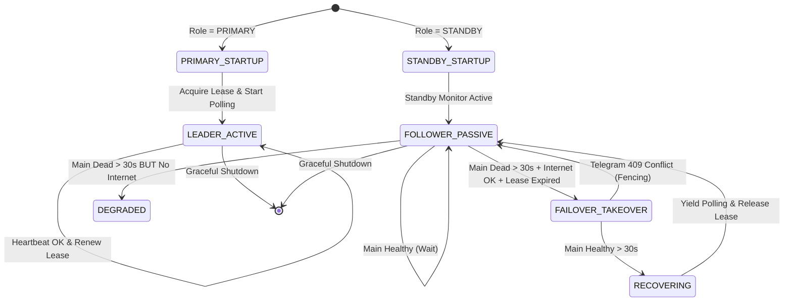

# BilioniD HA Sentinel — Архитектурный отчет и анализ ограничений

## 1. Обзор архитектуры

**BilioniD HA Sentinel** — распределенная отказоустойчивая система мониторинга инфраструктуры на базе двух VPS узлов в защищенной приватной сети Tailscale.

```
                    ┌───────────────────────────────────────────────┐
                    │               Telegram Bot API                │
                    │               (api.telegram.org)              │
                    └───────────────────────▲───────────────────────┘
                                            │
                        ┌───────────────────┴───────────────────┐
      Штатный режим:    │                                       │ Аварийный режим:
   getUpdates Polling   │                                       │ getUpdates Polling
                        │                                       │ (только при аварии Main)
     ┌──────────────────▼────────────────┐     ┌────────────────▼──────────────────┐
     │      MAIN (PRIMARY)               │     │      BACKUP (STANDBY)             │
     │ Host: Primary-VPS                 │     │ Host: Backup-VPS                  │
     │ IP: 100.64.0.1 (Tailscale)        │     │ IP: 100.64.0.2 (Tailscale)        │
     ├───────────────────────────────────┤     ├───────────────────────────────────┤
     │ • HA Supervisor (Лидер)           │◄────┼─► HA Supervisor (Резерв)          │
     │ • Telegram Polling (АКТИВЕН)      │     │ • Telegram Polling (ОСТАНОВЛЕН)   │
     │ • HA Endpoint (:29010)            │     │ • HA Endpoint (:29010)            │
     │ • Primary Beszel Hub (:29001)     │     │ • Backup Beszel Hub (:29000)      │
     │ • Uptime Kuma (:29000)            │     │ • SQLite Lease/Events (:local)    │
     │ • Docker Monitor (local socket)   │     │ • Docker Monitor (local socket)   │
     └───────────────────────────────────┘     └───────────────────────────────────┘
                       ▲                                         ▲
                       └───────────── Tailscale VPN ─────────────┘
                                  (Межсерверная сеть)
```

---

## 2. Карта портов и изоляция

| Сервер | Сервис | Порт | Протокол | Назначение |
|---|---|---:|---|---|
| **Main** | Uptime Kuma | 29000 | HTTP | Существующий мониторинг |
| **Main** | Beszel Hub (Primary) | 29001 | HTTP | Сбор метрик со всех агентов |
| **Main** | Portainer | 29002 | HTTP | Управление контейнерами |
| **Main** | SysTrack Web / Backend | 28000 / 28001 | HTTP | Мониторинг треков |
| **Main** | Погодный Telegram-бот | 20000 | HTTP/Bot | Внешний сервис |
| **Main** | **BilioniD HA Supervisor** | **29010** | HTTP (Tailscale) | Межсерверный heartbeat и статус |
| **Backup** | Beszel Hub (Backup) | 29000 | HTTP | Резервный сбор метрик |
| **Backup** | **BilioniD HA Supervisor** | **29010** | HTTP (Tailscale) | Межсерверный heartbeat и статус |

> [!IMPORTANT]
> Порт `29010` выбран установщиком как заведомо свободный на обоих VPS. Он не конфликтует с существующими сервисами (`20000, 28000, 28001, 29000, 29001, 29002` на Main и `29000` на Backup). Запросы к порту `29010` защищены pre-shared секретным ключом в заголовке `X-HA-Secret`.

---

## 3. Критическое ограничение: архитектура с двумя узлами (2-Node Cluster)

В инфраструктуре физически присутствуют только два сервера: `Main` и `Backup`. Независимый третий свидетель (Witness / Quorum Arbitrator) отсутствует.

### Теоретическое ограничение (CAP-теорема и кворум)
В классической теории распределенных систем невозможно строго математически гарантировать консенсус при произвольном разделении сети (Network Partition) между ровно 2 узлами без третьей независимой стороны. Если связь между Main и Backup оборвется, но оба сохранят доступ в интернет:
- Main считает, что Backup упал.
- Backup считает, что Main упал.
- Без защиты оба могут попытаться запустить Telegram polling (`getUpdates`).

### Архитектурное решение BilioniD HA Sentinel: Многоуровневая защита от Split-Brain

1. **Строгая асимметрия приоритетов (Primary Precedence):**
   - Main **всегда** имеет высший приоритет.
   - Backup никогда не перехватывает управление превентивно.

2. **Временной лаг переключения (Failover Threshold = 30 сек):**
   - Кратковременный сетевой сбой (джиттер) не вызывает ложного переключения.
   - Backup фиксирует аварию только после минимум 6 последовательно неудавшихся проверок (по 5 секунд).

3. **Комплексный зонд здоровья Main (Multi-Vector Probe):**
   - HTTP-запрос к `/health` на порт `29010`.
   - TCP-проверка порта `29010`.
   - Проверка доступности Main Beszel Hub (`http://<MAIN_IP>:29001/api/health`).
   - Если ХОТЯ БЫ ОДИН из сервисов Main отвечает — узел признается живым, переключение блокируется!

4. **Проверка внешней связности перед захватом (Outbound Egress Check):**
   - Перед тем как запустить polling, Backup обязан проверить доступность публичного Telegram API (`https://api.telegram.org`).
   - Если Backup потерял связь с Main И не может выйти в интернет (изолирован сам Backup) — он **не начинает polling**, переходит в статус `DEGRADED` и предотвращает ложный захват.

5. **Скользящий Lease (Аренда лидерства):**
   - Лидер удерживает запись lease в локальной БД со сроком истечения 15 секунд.
   - Перехват возможен только при истечении срока lease.

6. **Аппаратное / API Fencing через Telegram API (Telegram 409 Conflict):**
   - Telegram Bot API гарантирует, что одновременный вызов `getUpdates` от двух клиентов невозможен: второй клиент получает ошибку `HTTP 409 Conflict: terminated by other getUpdates request`.
   - При получении `TelegramConflictError` на резервном узле Backup **мгновенно останавливает polling**, переходит в статус `FOLLOWER_PASSIVE` и фиксирует событие `SPLIT_BRAIN_AVERTED`.

7. **Автоматический Failback с плавным Yield:**
   - После восстановления Main непрерывно проверяется Backup'ом в течение 30 секунд.
   - По истечении 30 секунд стабильности Backup вызывает `stop_polling()`, освобождает lease и возвращает роль `STANDBY`.
   - При старте Main отправляет сигнал `/ha/yield` на Backup для немедленной передачи управления.

---

## 4. Спецификация состояний FSM (Finite State Machine)



---

## 5. Интеграция с Beszel Hub

- Beszel Hub использует бекенд PocketBase.
- Метод чтения: `GET /api/collections/systems/records?perPage=50`.
- При сбое Primary Hub (`BESZEL_MAIN_URL`) клиент мгновенно переключает запросы на Backup Hub (`BESZEL_BACKUP_URL`).
- При недоступности обоих Hub активируется локальный сборщик метрик через `psutil` для текущего хоста.

---

## 6. Интеграция с Uptime Kuma

- Расположен на порту `UPTIME_KUMA_URL` (по умолчанию `:29000`).
- Чтение статусов осуществляется через стандартный endpoint `/metrics` в формате Prometheus (`monitor_status`, `monitor_response_time`), либо через статус-страницу `/api/status-page/heartbeat/default`.
- Является полностью отказоустойчивым и опциональным: недоступность Uptime Kuma не блокирует работу Telegram-бота.
